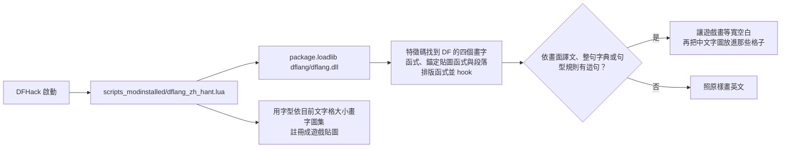

# MinidoracatDFLang

《矮人要塞》（Dwarf Fortress，Steam 版）的繁體中文與簡體中文化。翻譯引擎、字典與字型都是本專案自己的，繁中、簡中各發布成一個工作坊項目。

## 現況

- 遊戲版本：Dwarf Fortress 53.16＋DFHack 53.16-r2。
- 已翻譯：新玩家流程第一輪（標題、設定五個分頁、建立世界與生成、選出發地點、出發準備、進入要塞的上方資訊列與資訊面板分頁），含自動換行的段落（歡迎視窗、提示、抵達要塞）。整句 509 條、句型 48 條，繁簡分開翻。
- 尚未發布到 Steam 工作坊；翻譯接近完成後才發布。

## 玩家安裝（發布後）

1. Steam 安裝 [DFHack](https://store.steampowered.com/app/2346660/)（免費）。
2. 訂閱繁中或簡中項目，正常啟動遊戲。
3. 兩個都訂閱時預設繁中；在 DFHack 主控台輸入 `dflang lang zh-Hans` 或 `dflang lang zh-Hant` 切換，重開遊戲生效。

不能和 DFI18n、dfzh 等其他翻譯引擎同時使用，偵測到時本 MOD 不啟動。`dflang status` 查看狀態。

標題畫面左下角會出現本 MOD 的貓娘吉祥物和「繁體中文／简体中文」名牌。要移動或關掉，在 DFHack 主控台輸入 `gui/overlay`，找 `dflang_zh_hant.mascot`（簡中包是 `dflang_zh_hans.mascot`）。

## 運作方式



- DF 本身不載入 MOD 的原生程式；DFHack 會執行每個已安裝 MOD 的 `scripts_modinstalled/`，引擎就從這裡以 Lua `package.loadlib` 載入，只用 Lua C API，不綁 DFHack 版本。
- 中文字由遊戲自己的繪圖流程畫出：每個中文字佔兩格，字圖在遊戲啟動時依當下的文字格大小從思源黑體（Noto Sans CJK Medium）畫成，套用字型的 hinting，縮放不會糊。
- 遊戲執行時拼出的句子（名字、數字、隨機字詞）用句型規則翻譯，例如 `Histories of {1} and {2}` →「{1}與{2}的歷史」。同一個英文在不同畫面意思不同時，用只在該畫面套用的依畫面譯文。
- 自動換行的段落（說明、教學、彈出視窗）整段查字典、依中文規則重新換行，畫字時才換成中文；遊戲資料與存檔維持英文，移除本 MOD 不留痕跡。
- 函式位置用 `engine/patterns.tsv` 的特徵碼尋找，由 `scripts/make_patterns.py` 從遊戲執行檔產生；遊戲改版時重產即可。
- 標題畫面的吉祥物是 DFHack overlay 小工具：引擎啟動時把 `art/mascot.png` 縮成當下的格子大小、疊上名牌，畫在畫面頂層，透明處看得到標題背景。

## 目錄

```
data/strings/*.tsv         整句譯文：en, zh-Hant, zh-Hans, align, note（規則見 docs/translation-guide.md）
data/rules/*.tsv           句型規則：同上，en 含 {1}～{9} 佔位
data/screens/*.tsv         依畫面譯文：檔名是 DFHack 焦點字串的開頭，只在該畫面套用
glossary/terms.tsv         術語表；locale.tsv 兩岸用語規則
art/mascot.png             標題畫面吉祥物（透明背景 RGBA PNG；名牌文字由引擎在遊戲裡畫）
engine/                    Rust 引擎（cdylib dflang.dll）與特徵碼 patterns.tsv
lua/                       DFHack 載入器範本與 dflang 指令
scripts/
  build.py                 組出 dist/ 下的兩個工作坊包（含編譯引擎、裁字型）
  verify_mod.py            發版前驗證閘門
  terms.py                 術語一致與兩岸用語檢查
  lookup.py                查一句原文的現有譯文、術語、參考譯名與遊戲字串
  inventory.py             全文盤點：分類全部遊戲文字、對照實機紀錄，排出待翻清單（temp/inventory/）
  dev_game.py              本機實機測試：掛包、啟動、下指令、還原
  publish_workshop.py      兩包各自上傳工作坊（預設只檢查）
  make_patterns.py         產生／驗證特徵碼
  df_snapshot.py           遊戲文字盤點與 Ghidra 反編譯快照（產物在 repo 外，不公開）
  workshop.json            兩個工作坊項目的設定
docs/                      分析、翻譯指南、工作坊說明文
dist/                      建置產物（不進 git）
```

## 開發

需要 Windows、[uv](https://docs.astral.sh/uv/)、Rust（stable，MSVC 工具鏈）、Steam 版 Dwarf Fortress 與 DFHack。遊戲與 DFHack 位置從 Steam 自動偵測，可用環境變數 `DF_PATH`、`DFHACK_PATH` 指定。

```bash
uv run scripts/build.py --fetch-fonts         # 首次：下載思源黑體到 temp/fonts/
uv run scripts/build.py                       # 建置兩包（遊戲要先關：執行中會鎖住 DLL）
uv run scripts/verify_mod.py                  # 必須全部 PASS
uv run scripts/terms.py check                 # 術語與兩岸用語
cargo test --manifest-path engine/Cargo.toml --lib   # 句型比對的單元測試
uv run scripts/inventory.py                   # 待翻清單（需要反編譯快照）
uv run scripts/dev_game.py up --lang both     # 掛進遊戲並啟動
uv run scripts/dev_game.py run dflang status
uv run scripts/dev_game.py down               # 關遊戲、還原 mods/ 與設定
```

遊戲更新後先跑 `uv run scripts/make_patterns.py --check`。特徵碼找不到函式時引擎不啟動、遊戲維持英文，DFHack 主控台顯示 `[DFLang zh-Hant] addst 的特徵碼命中 0 次，這版遊戲可能還不支援`。重新定位的步驟見 [docs/analysis.md](docs/analysis.md) 的「遊戲更新」。

## 授權

- 譯文與術語表（`data/`、`glossary/`）：[CC BY 4.0](LICENSE-CC-BY-4.0.txt)。轉載或改作請註明出處。
- 其餘程式與文件：[MIT](LICENSE)。
- 吉祥物圖（`art/`）：© Minidoracat，保留所有權利，不在上述授權範圍內。
- 字型：思源黑體（Noto Sans CJK TC／SC Medium），SIL Open Font License 1.1，工作坊包內附授權全文。
- 致謝與參考來源見 [CREDITS.md](CREDITS.md)。
