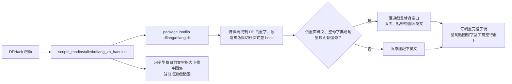

# MinidoracatDFLang

《矮人要塞》（Dwarf Fortress，Steam 版）的繁體中文與簡體中文化。翻譯引擎、字典與字型都是本專案自己做的，裝好 DFHack、訂閱工作坊項目就能玩；繁簡都在同一個項目裡，遊戲中隨時切換。

繁體中文與簡體中文是分開、逐句翻譯的：繁中用台灣用語，簡中用中國大陸用語，不是用工具互相轉換。

玩得再久也不會越吃越多記憶體：引擎的快取都設了上限，滿了就清；整句貼圖畫字用的貼圖最多 2,048 張，用不到的會釋放。遊戲中切換語言或粗體字時，用過的那份會留著直接重用，來回切換也不會一直增加。

- 工作坊：[繁體／簡體中文](https://steamcommunity.com/sharedfiles/filedetails/?id=3820630135)（原本的[簡體中文項目](https://steamcommunity.com/sharedfiles/filedetails/?id=3820630318)已合併進來，停在 0.4.0）
- 目前版本 0.5.5（Dwarf Fortress 53.16＋DFHack 53.16-r3），各版本的變更見 [CHANGELOG.md](CHANGELOG.md)

## 安裝

1. Steam 安裝 [DFHack](https://store.steampowered.com/app/2346660/)（免費）。
2. 訂閱本 MOD，正常啟動遊戲，標題畫面就是中文。建立新世界時不用勾選本 MOD。
3. 第一次啟動時照 Steam 的介面語言選繁中或簡中（Steam 不是中文時看 Windows 的顯示語言與地區格式，都不是中文時用繁中）；想換就在設定視窗切換，之後會記住。

## 翻譯範圍

- 標題、設定（含按鍵設定）、模組管理員、存檔清單。
- 建立世界（含詳細參數與被拒絕的原因）、選出發地點、出發準備。
- 要塞模式：資訊面板各分頁、人物頁、物品與建築頁、建造與區域選單、工作指令、軍事、司法、商隊交易、公告與戰鬥報告、提示框。
- 冒險模式：建立角色、教學與說明、交談、日誌、戰鬥與合成選單。
- 傳說模式：歷史事件，人物、勢力、據點、地區頁，作品的書名。
- 世界生成的名稱（照遊戲的組字規則組成中文）、神造材料與神話物質。
- DFHack 的控制面板、launcher、快速入門指南、overlay 與常用工具視窗。

共有整句 55,504 條、句型 27,608 條、依畫面譯文 644 條、名稱字表 3,301 條、音譯表 327 個音節。

照原文的部分：玩家自己輸入的文字、玩家取的名字、第三方模組的名稱與說明、DFHack 的工具名與指令、主控台輸出；配樂曲名預設照原文，可以在設定視窗改成中文。矮人語等原生語言的名字預設音譯成中文，可以在設定視窗改回原文。沒翻到的字維持英文，不影響遊戲。

## 設定視窗

遊戲中任何畫面按 `Ctrl-Shift-L`（或在標題畫面點吉祥物）開「DFLang 設定」，再按一次關掉。標題畫面左下角的名牌和設定視窗的標題都會顯示版本號，回報問題時請一起附上。

| 項目 | 說明 | 預設 |
|---|---|---|
| 顯示中文 | 關掉暫時改看英文 | 開 |
| 語言 | 繁中或簡中；沒選過時照 Steam 或 Windows 的語言 | 照系統 |
| 整句貼圖 | 照字型的實際字寬整行畫字，調整視窗或介面縮放後也清楚；和其他改畫面的 MOD 衝突時可以關掉，改回一字兩格的舊畫法 | 開 |
| 中文字型大小 | 13～16（格高的十六分之幾），數字越大字越大 | 14 |
| 粗體字 | 關掉改用一般粗細 | 開 |
| 原生語言名字音譯 | 矮人語等原名轉成中文（「Rigòth Nildum」→「里戈斯·尼爾杜姆」）；比英文寬一點時稍微壓窄，再放不下照英文。關掉照原文 | 開 |
| 按鍵名翻成中文 | 按鍵設定與 DFHack 快捷鍵提示（「小鍵盤 Enter」「[」）；鍵帽上印的 Tab、Esc、F 鍵照英文 | 開 |
| 配樂曲名翻成中文 | 暫停選單的曲名 | 關 |
| 段落缺句時其餘照翻 | 一整段有句子沒翻到時，翻得出來的先顯示中文（關著時整段照英文） | 關 |
| 記錄未翻譯的字 | 見下方「回報問題」 | 關 |

設定改了立即生效，不用重開遊戲，畫面上已經排好的長文（彈出視窗、人物頁的性格、傳說頁）也跟著換。只有在語言選「其他翻譯 MOD」（改用 DFI18n、DFCN）時要重開，視窗會以黃字提示。遊戲正在讀取時，以及打開過「建立新世界」的設定畫面之後，換語言與粗體字可能要等載入或建立世界後才自動切換，其他設定照樣立即生效，視窗同樣以黃字提示。DFHack 主控台的 `dflang` 指令也能改這些設定（`dflang` 不加參數看用法）。快捷鍵只在遊戲執行時註冊，想換鍵用 DFHack 的 `gui/keybinds`；標題畫面的吉祥物與提示可以用 `gui/overlay` 移動或關掉（`dflang_zh_hant.mascot`、`dflang_zh_hant.hint`）。

## 搜尋框打拼音

遊戲的搜尋框（庫存、傳說清單…）與 DFHack 視窗的清單搜尋，除了英文，也可以打中文名稱的拼音：全拼（`tiekuang`）、首字母（`tk`）或混著打（`tiek`）都找得到「鐵礦」，多音字每個讀音都算，ü 打 v 或 u 都可以。繁體、簡體都能用。

- 用英文輸入狀態打：輸入法打出的中文字，遊戲的搜尋框收不到。
- 傳說模式這種上萬項的清單，第一次打字時拼音只比得到一部分，兩三秒後再打一個字就完整。

## 和其他翻譯 MOD 一起裝時：本 MOD 優先讓位

翻譯引擎一次只能有一個在運作。同時裝了 DFCN 或 DFI18n 時，本 MOD 不搶著接手，遊戲照用原本的翻譯 MOD，只在標題畫面跳出中文說明，讓你選要用哪一個（重開遊戲生效）：

- 停用 DFI18n：在遊戲的 `mods` 資料夾放一個 `dflang-hide-dfi18n`，DFHack 就不載入 DFI18n（DFI18n 本身的檔案不動；找不到本 MOD 時，下次啟動會自己刪掉）。
- 停用 DFCN：把遊戲目錄的 `dfhooks_dfcn.ini`（舊版 DFCN 是 `dfhooks_dfcn.dll`）加上 `.disabled-by-dflang` 改名。
- 之後想換回另一個，在 DFHack 主控台輸入 `dflang lang off`，之前停用的會恢復。退訂本 MOD 前想用回 DFCN，也先輸入這個指令。

裝了 dfzh 時本 MOD 不啟動，標題畫面用英文說明怎麼移除。

## 回報問題

在設定視窗打開「記錄未翻譯的字」（之後每次啟動都會繼續記錄，直到關掉），照平常玩到沒翻的畫面，再按「開啟紀錄所在資料夾」，把遊戲目錄的 `dfhack-config/dflang-misses.tsv` 附到 [GitHub Issues](https://github.com/Minidoracat/MinidoracatDFLang/issues)，或把內容貼到工作坊的「問題回報」討論串（[繁中](https://steamcommunity.com/workshop/filedetails/discussion/3820630135/574929940135291802/)、[簡中](https://steamcommunity.com/workshop/filedetails/discussion/3820630318/574929940135291861/)；討論串不能附檔，內容太長時貼相關畫面的幾行）。紀錄會記下畫面上所有沒翻到的英文，包括你世界裡的名字；回報完可以按「清除紀錄」。

## 運作方式



- DF 本身不載入 MOD 的原生程式；DFHack 會執行每個已安裝 MOD 的 `scripts_modinstalled/`，引擎從這裡以 Lua `package.loadlib` 載入，只用 Lua C API，不綁 DFHack 版本。
- 遊戲的格子裡照英文的版面寫替身空白，渲染器每幀畫完格子後，引擎把每一行字照思源黑體的實際字寬畫成貼圖疊上去（整句貼圖），對齊照遊戲擺英文的位置。
- 遊戲執行時拼出的句子（名字、數字、隨機字詞）用句型規則翻譯（`Histories of {1} and {2}` →「{1}與{2}的歷史」）；同一個英文在不同畫面意思不同時，用只在該畫面套用的依畫面譯文。
- 自動換行的段落與提示框整句查字典、依中文規則重新換行，畫字時才換成中文；遊戲資料與存檔維持英文，移除本 MOD 不留痕跡。
- 函式位置用 `engine/patterns.tsv` 的特徵碼尋找，由 `scripts/make_patterns.py` 從遊戲執行檔產生，遊戲改版時重產即可。設計細節與已知限制見 [docs/analysis.md](docs/analysis.md)。

## 目錄

```
data/strings/*.tsv         整句譯文：en, zh-Hant, zh-Hans, align, note（規則見 docs/translation-guide.md）
data/rules/*.tsv           句型規則：同上，en 含 {1}～{9} 佔位
data/events/*.tsv          傳說事件句樣板：scripts/gen_events.py 展開成 data/rules/_events.tsv、zz_events.tsv（產物，別手改）
data/names/*.tsv           世界生成名稱的中文字表（字的代號、詞性、中文）
data/translit/translit.tsv 原生語言名字的音譯表（音節 → 中文，設定視窗的名字音譯開著才用）
data/screens/*.tsv         依畫面譯文：檔名是 DFHack 焦點字串的開頭，只在該畫面套用
glossary/terms.tsv         術語表；locale.tsv 兩岸用語規則
art/mascot.png             標題畫面吉祥物（透明背景 RGBA PNG；名牌文字由引擎在遊戲裡畫）
engine/                    Rust 引擎（cdylib dflang.dll）、特徵碼 patterns.tsv、拼音搜尋的讀音表 pinyin.tsv
lua/                       DFHack 載入器範本、dflang 指令、蓋掉舊簡中項目載入器的空檔（retired_zh_hans.lua）
scripts/
  build.py                 組出 dist/ 下的工作坊包（繁簡兩種語言各一個資料夾；含編譯引擎、裁字型）
  gen_events.py            由 data/events 產生事件句的句型（日期、原因的各種組合）
  verify_mod.py            發版前驗證閘門
  terms.py                 術語一致與兩岸用語檢查
  regress.py               譯文回歸比對：同一批樣本在某個 git 版本與目前工作目錄的譯文差異
  lookup.py                查一句原文的現有譯文、術語、參考譯名與遊戲字串
  inventory.py             全文盤點：分類全部遊戲文字、對照實機紀錄，排出待翻清單（temp/inventory/）
  dev_game.py              本機實機測試：掛包、啟動、下指令、送按鍵、截圖、列出畫面上的字、量分頁置中、還原
  dev_lua/                 實機測試用的 DFHack 腳本（dev_game.py up 裝成 dflang-dev-<名稱>，down 刪掉）
  dev-play.cmd             啟動器（雙擊）：建置、開遊戲，遊戲關掉後自動還原
  publish_workshop.py      上傳工作坊（預設只檢查；標題與說明分繁簡兩種語系）
  make_patterns.py         產生／驗證特徵碼
  make_pinyin.py           從 Unicode Unihan 產生拼音讀音表 engine/pinyin.tsv（譯文用到新的漢字時重跑）
  df_snapshot.py           遊戲文字盤點與 Ghidra 反編譯快照（產物在 repo 外，不公開）
  workshop.json            工作坊項目的設定、兩種語言與版本號
docs/                      分析、翻譯指南、工作坊說明與每版的更新說明（steam/）
CHANGELOG.md               各版本的變更（發版前先記）
dist/                      建置產物（不進 git）
```

## 開發

需要 Windows、[uv](https://docs.astral.sh/uv/)、Rust（stable，MSVC 工具鏈）、Steam 版 Dwarf Fortress 與 DFHack。遊戲與 DFHack 位置從 Steam 自動偵測，可用環境變數 `DF_PATH`、`DFHACK_PATH` 指定。

```bash
uv run scripts/build.py --fetch-fonts         # 首次：下載字型與授權到 temp/fonts/
uv run scripts/gen_events.py                  # 改過 data/events 後重產事件句型
uv run scripts/make_pinyin.py                 # 譯文用到新的漢字後重產拼音讀音表（verify_mod 會提醒）
uv run scripts/build.py                       # 建置（遊戲要先關：執行中會鎖住 DLL）
uv run scripts/verify_mod.py                  # 必須全部 PASS
uv run scripts/terms.py check                 # 術語與兩岸用語
uv run scripts/regress.py                     # 改句型後：舊樣本的譯文和 HEAD 比（--base v0.5.4 和舊版比）
cargo test --manifest-path engine/Cargo.toml --lib   # 引擎的單元測試
uv run scripts/inventory.py                   # 待翻清單（需要反編譯快照）
uv run scripts/dev_game.py play               # 啟動器：建置、掛進遊戲並啟動，遊戲關掉後自動還原（scripts/dev-play.cmd 雙擊同）
uv run scripts/dev_game.py up --lang auto     # 掛進遊戲並啟動（auto 照系統判斷語言，也可指定 zh-Hant、zh-Hans）
uv run scripts/dev_game.py run dflang status
uv run scripts/dev_game.py screen             # 目前的畫面（焦點）與畫面上的每段字
uv run scripts/dev_game.py shot temp/a.png    # 遊戲視窗截圖（原解析度；--crop X Y W H 只截一塊）
uv run scripts/dev_game.py sweep              # 從目前畫面把分頁一路點開，量分頁標籤置中、收集未翻譯紀錄
uv run scripts/dev_game.py down               # 關遊戲、還原 mods/ 與設定
```

遊戲更新後先跑 `uv run scripts/make_patterns.py --check`。特徵碼找不到函式時引擎不啟動、遊戲維持英文，DFHack 主控台顯示 `[DFLang] addst 的特徵碼命中 0 次，這版遊戲可能還不支援`。重新定位的步驟見 [docs/analysis.md](docs/analysis.md) 的「遊戲更新」。

發布（要先取得維護者同意）：改 `scripts/workshop.json` 的版本號，在 [CHANGELOG.md](CHANGELOG.md) 記這一版，再整理成繁簡兩份工作坊更新說明 `docs/steam/changelog-zh-Hant.bbcode`、`changelog-zh-Hans.bbcode`（只放這一版，第一行要有版本號），上傳時兩份接在一起。上傳腳本先檢查兩者都有這一版、README 的版本與數量和建置一致、Steam 沒在執行遊戲；上傳完用 Steam Web API 確認項目公開、大小和 `dist/` 一致（`--verify` 可以單獨跑）。

```bash
uv run scripts/publish_workshop.py [--screenshots] --yes             # 上傳內容、封面、繁簡兩種語系的標題與說明、更新說明
uv run scripts/publish_workshop.py --description-only [--screenshots] --yes   # 只換說明（加 --screenshots 連截圖一起換），不傳內容、不算發布新版
uv run scripts/publish_workshop.py --retire --yes                    # 已合併的簡中項目：換成「已合併、請改訂閱」的標題與說明，設成不公開列出
git tag -a v0.5.5 -m "0.5.5" && git push origin v0.5.5                         # 每次發布都打 tag，版本號照 workshop.json
```

## 授權

- 譯文與術語表（`data/`、`glossary/`）：[CC BY 4.0](LICENSE-CC-BY-4.0.txt)。轉載或改作請註明出處。
- 其餘程式與文件：[MIT](LICENSE)。
- 吉祥物圖（`art/`）與工作坊封面（`docs/steam/cover-*.gif`）：© Minidoracat，保留所有權利，不在上述授權範圍內。
- 字型：思源黑體（Noto Sans CJK TC／SC Bold、Regular）與補 ☼ 用的 Noto Sans Symbols 2，SIL Open Font License 1.1，工作坊包內附授權全文。
- 引擎靜態連結的開源 Rust 套件（skrifa、zeno、png、retour 等）各依原授權，包內 `dflang/THIRD-PARTY-LICENSES.txt` 附授權全文（建置時產生）。
- 拼音搜尋的讀音表（`engine/pinyin.tsv`）由 Unicode Unihan 資料庫產生，依 Unicode License V3（[engine/LICENSE-unicode.txt](engine/LICENSE-unicode.txt)），全文也附在包內的 `THIRD-PARTY-LICENSES.txt`。
- 致謝與參考來源見 [CREDITS.md](CREDITS.md)。
