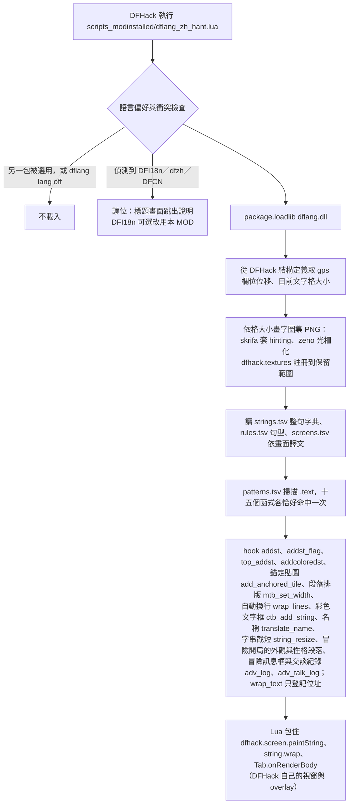

# 矮人要塞中文化：技術分析與路線

調查日期 2026-10-14；遊戲 Dwarf Fortress Steam 53.16（buildid 24557528）、DFHack 53.16-r2。對照的既有方案：DFI18n 0.2.4、維基翻譯組簡中資料 0.0.15、dfzh、dfint。

## 結論

1. **中文一定要靠原生程式顯示。** DF 的介面文字畫在 CP437 點陣字上（256 格），raws 改名或換字型圖都放不進幾千個漢字。可行的做法是在遊戲畫字時攔下英文、換成中文字圖。
2. **DFHack 是唯一的載入管道。** DF 不從 MOD 載入原生程式；DFHack 會執行每個已安裝 MOD 的 `scripts_modinstalled/`，Lua 再以 `package.loadlib` 載入 DLL。玩家只要從 Steam 裝 DFHack（免費）、訂閱工作坊項目，不必手動複製檔案。
3. **本專案自寫引擎，不依賴其他翻譯 MOD。** 繁中、簡中各一個工作坊項目，每包都帶完整引擎、字典與字型；兩包同時安裝時由設定檔決定用哪一種。
4. **中文字交給遊戲自己畫。** 字典命中時讓遊戲畫等寬空白，再把那些格子的貼圖換成中文字圖；顏色、圖層、裁切都沿用遊戲的繪圖流程，不會先閃英文。
5. **現有簡中確實不全。** 以字面比對估算，exe 內大寫開頭的獨立 UI 句子約 21% 有譯文，raws 名稱約 71%；事件提示、人物特性與需求、程序生成敘述多半還是英文。

## 遊戲與 MOD 機制

| 項目 | 實況 |
|---|---|
| 執行檔 | `Dwarf Fortress.exe` 25 MB、x64、無 PDB；DFHack `symbols.xml` 有 `v0.53.16 win64 STEAM`（PE 時間戳 0x6A70A6D9） |
| 文字繪製 | `graphicst::addst`、`addst_flag`、`top_addst`、`addcoloredst` 把字寫進 `gps` 的畫面緩衝區；每格有字元、顏色、貼圖編號（texpos）與旗標 |
| 人物頁的長文 | 想法、記憶、性格（特質、價值觀、偏好、需求）、屬性由各自的組字函式拼成一整段（例：`thought_composer` 0x140e2c460 拼原因片語），含 `[C:…]` 換色標記，交給彩色文字框（`color_text_boxst`）的 add_string（0x140858550）依框寬切行，再逐行用 `addcoloredst` 畫；訪客說明拼成一整段交給 `wrap_text` |
| DF 的 MOD | `info.txt`＋資料；工作坊訂閱會複製到 `%APPDATA%/Bay 12 Games/Dwarf Fortress/mods/<ID> (<版本>)`；不載入原生程式 |
| DFHack | Steam 版把 `dfhooks.dll` 放進遊戲目錄，遊戲啟動就載入；掃描工作坊、`mods/`、`data/installed_mods/` 三處 MOD，執行其 `scripts_modinstalled/`（`hack/lua/script-manager.lua`）；同一 MOD ID 只執行最高版本 |

## 文字量（53.16 L1 快照）

| 來源 | 數量 | 說明 |
|---|---:|---|
| exe 字串（`.rdata`／`.data`） | 52,202 | 其中像文字的 31,986 條；含大量片段（如 `" is visiting."`），要靠規則組句 |
| exe 大寫開頭的獨立句子 | 11,349 | 粗估 UI 句數；也含錯誤訊息等玩家看不到的字 |
| raws 文字 | 25,935 列 | 名稱 `NAME` 1,641、`CASTE_NAME` 1,312、描述 968、偏好 1,155、攻擊動詞 903、身體部位 996 等；`T_WORD` 8,784 是矮人語等人造語詞，不翻 |
| TEXT_SET 句型 | 350 | 書名、對話、仇敵描述的範本，如 `A Course on [NAME]` |
| 程序生成 Lua | 621 | `vanilla_procedural/scripts`，遺忘巨獸等生物的描述零件 |

## 既有方案

| | DFI18n（Viz） | dfzh（0x53an） | dfint |
|---|---|---|---|
| 形式 | 工作坊 MOD；Lua 以 `package.loadlib` 載入 Rust DLL | 工作坊 MOD；把 C++ 外掛複製進 `hack/plugins`、`SDL2_ttf.dll` 複製進遊戲目錄 | 安裝程式把 hook 放成 `dfhooks.dll`、換掉 `curses_640x300.png` |
| 需要 DFHack | 是 | 是 | 否；與 DFHack 的 `dfhooks.dll` 衝突 |
| 綁 DFHack 版本 | 否 | 是，每個 DFHack 版本各編一顆 | 否 |
| 中文字 | 可（fontdue 畫字，另外疊一層） | 可（SDL2_ttf） | 不可，256 格點陣字 |
| 攔字方式 | 特徵碼找 17 個 DF 函式並 hook | 每幀掃畫面緩衝區，用位置猜句子 | hook＋CSV 字典 |
| 授權 | 程式 MIT；簡中資料 CC BY-NC 4.0 | 程式 MIT；資料 CC BY-NC 4.0 | MIT |

DFI18n 0.2.4 在 53.16 的缺口（研究時的觀察，也是本專案自寫引擎的理由之一）：DFHack 文字 hook 失效（`paintString` 在 DFHack 53.15-r3 移到 `dfhack.dll`）；新的組字路徑沒接；中文字佔 1.5 格，譯文超出原文寬度會被截斷（實測 `Quit`→「結束遊戲」只剩「結束」）；要等遊戲下一次重畫才換成譯文，開視窗時先閃英文；公開原始碼停在 0.2.2。

## 本專案引擎

hook 內的流程：

1. 以整句英文（CP437 位元組）查字典：先查目前畫面的依畫面譯文（Lua 每幀把 DFHack 焦點字串傳給引擎，DFHack 的視窗開著時也加上底下遊戲畫面的焦點；限定了列的條目還要畫在那一列），再查整句字典，再依序比對句型規則（結果與「沒中」都存進快取，下一幀直接用；「沒中」與還夾著英文的結果記下當時名稱表的版本，之後登記了新的世界生成名稱就重算），最後試被截短的字串（第 17 點）；都沒中就照原樣呼叫原函式。
2. 命中時，把譯文換成「每個中文字兩個空白」的影子字串交給原函式畫，遊戲照常處理座標、顏色與裁切。句型填入片段後比原文寬就放棄，照畫英文。
3. 原函式返回後，在那些格子寫入中文字圖的 texpos，並設 `ADDCOLOR` 旗標讓字圖套用該格的前景色。分頁標籤這類往下位移半格的文字，遊戲在上下兩列各寫一次（上列標 `TOP_OF_TEXT`、下列標 `BOTTOM_OF_TEXT`，用字型表的半格字形）；這兩種格子改貼「往下位移半格」的字圖上下兩半，位置和英文相同。
4. 自動換行段落（`markup_text_boxst`，說明頁、教學、彈出視窗）：遊戲先把整段拆成單字，排版函式 `mtb_set_width` 算出每個單字的座標，再逐字畫出，畫字 hook 只看得到單字。所以另外 hook 排版函式：原函式排完英文後，把單字接回整段（換行與換色寫成遊戲的 `[R]`、`[B]`、`[P]`、`[C:前景:背景:亮度]` 標記，顏色寫成調色盤編號）查字典；有譯文就依中文規則重新換行（標點不放行首、英數詞不拆），替每個單字訂畫字計畫：每段中文交給同一列第一個英文單字（載體）畫，畫在載體座標加上位移的位置，其他單字不畫。捲動的清單裡遊戲依載體決定畫不畫，中文那列跟著一起出現或消失。
5. 遊戲的單字清單一律不改：彈出視窗排好的單字會存進存檔。早期做法把單字原地改寫成代號，實測要塞存檔 `world.sav` 解壓後有 11 個代號（抵達要塞的彈出視窗），讀檔或移除本 MOD 後會畫成亂碼。
6. 沒有譯文的段落照畫英文，遊戲一樣逐字畫：單字若剛好是字典裡的介面標籤（`All`、`Fish`）會被換成中文、夾在英文句子裡（實測編年史出現「The Paddles of 全」）。所以排版時也替這些單字登記「照畫英文」，畫字 hook 遇到就不查字典。段落釋放時沒有通知，位址可能被別的字串重用，所以座標也要和排版時相同才算。傳說頁照原文的段是譯文的一部分，跟著中文一起重新排版。
7. 錨定貼圖：出發準備畫面開了圖形時，分頁標籤（矮人、物品、動物…）不經畫字函式，遊戲把每個字元當成 1×2 格的錨定貼圖（`add_anchored_tile`，貼圖編號取自字型表 `small_font_texpos`／`large_font_texpos`）一格一格放。hook 依貼圖編號反查字元，把同一列連續的字元接成標籤，等下一個不相連的貼圖或畫字呼叫時查字典；命中就把那些格子的錨定貼圖換成中文字圖，置中。錨定貼圖照原尺寸從固定的上緣畫起，英文字型表的字（8×12）大寫字母約 10 px；一般大小的中文會壓到分頁下緣，所以標籤另用小一號（字身 0.75 格高）、靠上的字圖。
8. 自動換行的文字（工具列按鈕的提示框、訪客說明、人物頁概況的近期想法、冒險模式的宗教說明與日誌事件等）：遊戲用 `wrap_text` 把一段英文依寬度切成幾行（`vector<string*>`），再一行一行畫，整句比對只看得到片段。`wrap_text` 只是把一個字串包成一段再呼叫真正切行的 `wrap_lines`（輸入是接成一句的幾段字串），也有程式直接呼叫 `wrap_lines`，所以 hook `wrap_lines`：切好之後把輸入接回整句查字典，查不到就逐句查（見第 11 點），有譯文就依中文規則以同樣寬度重新換行，第 k 行中文交給第 k 行英文畫，多的英文行不畫；沒有譯文的行登記成「照畫英文」，畫到時把整句記進未翻譯紀錄（不記片段）。行字串可能被釋放後重用，計畫以位址登記、畫字時再比對內容。
9. 大部分提示框在遊戲啟動時的靜態初始化就切好了，早於本引擎載入，hook 攔不到。所以 `enable` 時掃描 .text 裡呼叫 `wrap_text` 的地方，找出三個參數都是常數的呼叫（`lea rcx,[rip+全域變數]`、`mov r8d,寬度`、前面剛組好的 `lea rdx,[rip+字串]`），讀出全域變數裡已切好的行，和原文的單字完全相同才補登記（53.16 有 575 句）。
10. 彩色文字框（人物頁的想法、記憶、性格、屬性）：遊戲把含換色標記的一整段交給 add_string，切成固定長度的行（`color_text_linest`：文字與每字顏色各 769 bytes），再逐行用 `addcoloredst` 畫。hook add_string：原函式切完後，去掉換色標記（每個字記下顏色）、在 `[P]`、`[R]`、`[B]` 處分段，逐段逐句查字典；全部都有譯文才依框寬重新換行，第 k 行中文交給第 k 行英文畫，譯文依原文位置上色（佔位的譯文用佔位原文的顏色，句型固定字用該句開頭的顏色）。缺一句就整段照畫英文，不拿行片段查字典，缺的句子記進未翻譯紀錄。
11. 逐句：遊戲拼段落時句間空兩格。整段查不到時在句末標點（`.` `!` `?` `"`）後的兩個以上空白處切句，每句各自查整句字典與句型。句型的佔位不能跨過這種句界，整段比對時才不會把下一句吞進佔位。整段用雙引號包住時（人物頁概況的引言），引號內一樣逐句查，引號換成字典 `""` 條目的譯文（「」、“”）。段落框還原句界時引號裡的不還原（石板刻文整段引在一句裡），但整段只有外框一對引號時（神明對天選者說的話）外框不算引號，裡面照樣還原。
12. 公告：遊戲把一則公告拼好存成報告（`world.status.reports`），左側警報清單用 `wrap_text` 畫（第 8、11 點），標 BOX 的種類另用段落框彈出（第 4 點）。段落框把單字接回時單字間只留一個空白、`[B]` 自成一字，和報告原文的空白不同：載入字典時替原文有連續空白或黏著 `[B]` 的條目與句型另登記這種寫法的別名，一條兩處都能用。
13. 查詞時大小寫不同也找得到：完全相同的寫法優先，再試全小寫，再試只差大小寫的條目（索引在載入時建好；只差大小寫的兩條譯文不同時不收）。公告常把介面上大寫的名稱寫成小寫（`the woodcutter`、`Trade Depot`）。
14. 戰報：遊戲把攻擊者、動詞、受擊者、部位、武器、傷勢一段段接成一句。句型分層寫（攻擊前綴只用在佔位裡，由傷勢外框接上），所有格 `{%1}'s {%2}` 也只用在佔位裡。攻擊者自己的部位（`with The woodcutter's right lower arm`）用可省略的佔位 `{~n}`，譯文不必重寫主人。部位名本身帶逗號（`first toe, right foot`）：片段以這種條目結尾、前面又不是清單的「, 」時，不套清單句型，整條當部位名。
15. 傳說模式的事件句：遊戲替每種歷史事件（`history_event_*st`，133 種）各有兩個描述函式，vtable +0xd0 拼完整句（「In 1, X settled in Y.」，日期由 FUN_140b92640 寫在句首），+0xd8 拼名詞短語（「the founding of X in 3」，日期在結尾），+0x110 是 XML 匯出不翻。句型來源寫在 `data/events`，由 `scripts/gen_events.py` 產生帶日期的整句與短語、依「誰的樣板比較通用」排序（見 translation-guide「傳說模式的事件句」）。很多事件在句號前接原因與情境（FUN_140b5a6c0，94 種原因、約 25 種情境）：字典裡 align 寫 `tail` 的片語另外存，查一段文字時句尾（短語則是結尾日期前）是這種片語就先去掉、其餘照常翻，再在句號前補「，片語」，最多兩段。句子以日期結尾（The artwork relates to … in 3.）時日期與片語屬於裡面的短語，這一層不去。
16. 有連結的段落（傳說頁）是一筆筆紀錄：整段查不到時一段（`[B]`／`[R]`／`[P]` 之間）一段翻，翻不出來的段照原文、整段記進未翻譯紀錄；一般段落（說明、彈出視窗）仍是缺一段就整段照英文。有換色標記的段（相關人物清單的 `[C:7:0:0](member)`）整段查。
17. 被截短的字串：分頁標籤、清單放不下時遊戲把字串截成「開頭...」（`Historical f...`、`Start new conversation with the Human baro...`），整句查不到。執行檔裡有 172 處是同一種寫法：`std::string::resize` 縮短，再把最後三格寫成句點。所以 hook `resize(新長度, 填充字元)`：字串縮短時記下縮短前的原文（每個執行緒各留最近 16 筆，遊戲在同一執行緒縮短後馬上就畫；世界生成等其他執行緒的縮短不會混進來）；查到「開頭...」時先找開頭相同、比它長的原文，翻原文再依截短後的格數截短，放不下就接「…」。同一清單裡可能有好幾個「the Human baro...」是不同的人，這條路不進快取。記錄裡沒有時（遊戲啟動前就截好、或不經 `resize`）找整句字典裡以這段開頭、又比它長的原文；只有一種譯文（不計結尾的空白與冒號）時用它。開頭相同、譯文不同的有兩句以上時照英文。本來就以刪節號結尾的字串（載入進度 `Items...`）寫成整句條目，整句先查，不會被當成截短。
18. 冒險者開局畫面的外觀與性格段落：遊戲把 `wrap_lines` 的切行程式整段複製進自己的函式（FUN_140639440 寬 77、FUN_14063a7d0 寬 78），切好的行存在冒險者資料的行清單裡（+0x1370 外觀段，後面接一行空白和 `wrap_text` 切的種族說明；+0x1398、+0x13b0、+0x13c8 性格、價值觀、文化），畫字時一行一行畫。hook 這兩個函式：原函式跑完後讀出行清單，把行接回整段（換行處被跳過的句間空白補回，逐句查要靠它切句），照第 8 點登記畫字計畫。位移照 53.16 寫死，改版時特徵碼對不上就不攔，只有這幾段照英文。
19. DFHack 自己的視窗與 overlay（控制面板、launcher、標題畫面的 DFHack 選單、存檔提醒…）不經遊戲的畫字函式：DFHack 的 Lua 介面一段段呼叫 `dfhack.screen.paintString(pen, x, y, 字)`，C++ 逐格寫進畫面緩衝區。載入器在引擎啟用時把它換成包裝函式：先問引擎（`dh_translate`，查法同第 1 點，頭尾空白照原文、補到原長），有譯文就呼叫原函式畫影子字串（格數、顏色、裁切、點擊範圍都照英文），再請引擎在同樣的格子貼字圖（`dh_stamp`：DFHack 開著頂層時只寫頂層，字圖跟著貼頂層；不看遊戲的裁切框，裁切已由 DFHack 的 Painter 做完）。說明段落（`WrappedLabel`、確認對話框）在 Lua 先用 `string:wrap` 切成英文行：包住 `string.wrap`，原函式切完後把整段與英文行交給引擎（`dh_wrap`）。引擎照原文的 `\n` 分段（一段的英文行扣掉空白的字數加起來就是那一段的字數），每段各自翻、以同樣寬度重新換行，中文列依序放進同一段的英文行，中文比較短時多的英文行畫空白，段落間的空行和段首縮排照留；登記成「英文行 → 中文」，之後畫到那一行英文就畫中文。輸入框（`EditField`、`TextArea`）畫內容與切行時不查字典，玩家打的字照原樣。圖形模式的分頁標籤一格一字畫上下兩列（上列的筆標 `top_of_text`、下列標 `bottom_of_text`），覆寫 `Tab.onRenderBody`：標籤整個在裁切範圍內才換，兩列都畫影子字串、各貼一次字圖，引擎依格子的旗標貼字的上下兩半（第 3 點）。這些覆寫都先檢查函式存在，DFHack 改版後不在就略過。
20. 冒險模式上方的訊息框（FUN_1408020c0）與交談畫面上方的交談紀錄（FUN_140867e10）：每則報告（`df.report`，全文在 +8）先依框寬切成幾行，行清單是 `vector<行*>`（訊息框在介面 +0x43d0，交談畫面在 +0xb0），每行開頭是那一行的 std::string，+0x20 指回報告；只有一行的報告，行字串是空的，畫的是報告的全文。之後一行行用 addst 畫，整句比對只看得到片段，兩句以上的一則（「You: Hello Medi.  Long live the cause!」）也比不到。hook 這兩個畫字函式：原函式畫之前把行清單依報告分組，整則（「講者: 內容」）查字典、查不到就逐句查，中文以這幾行最長的一行為寬重新換行，照第 8 點登記每一行的畫字計畫。位移照 53.16 寫死，改版時特徵碼對不上就不攔，只有這兩個框維持英文。
21. 作品的書名（FUN_140c20b70 建立作品時呼叫 FUN_140ee4870 選樣板組、FUN_140ee35f0 代換佔位，存在 written_content+0x08，之後一律照存的英文畫）：樣板取自 raws 的 `TEXT_SET:BOOK_INSTRUCTION`（155 行，手冊、指南、論文…）與 `BOOK_ART`（18 行，詩、樂曲、舞蹈、小說…）；[NAME] 依作品的主題（知識主題 551 個、事件名詞、價值觀、神的領域、地點、人物、神器的固定詞或英文名，沒有主題時是一個隨機名詞），[NO_ART_NAME] 是 [NAME] 刪掉所有「the 」（FUN_140ede350），[ADJ]／[NOUN] 是 raws 字表的英文詞形、每個字改大寫，[PHRASE] 由 5／14／7／4 個固定詞組成，最後只把整串第一個字母改大寫。引擎在畫的時候拆回去：句型的 `{$n}` 收主題（書名用詞是另一張表，字串檔 `align` 寫 `title`，載入時另存去冠詞的寫法；也收字表名詞、「the＋一般字典的字」、名稱表登記過的名字、別的書名句型），`{&n}`、`{=n}` 查字表的英文詞形（`names.rs` 從 `names.tsv` 第四欄建表，大寫開頭才收）。書名句型的固定字可以比到原文的大寫寫法（編年史把作品名每個字改大寫），反過來不行。任意佔位抓到只有主題的書名、整串畫出的多字主題，最後查書名用詞。
22. 整句貼圖（0.2.0 起預設；`dflang overlay off` 改回第 2、3 點的一字兩格字圖）：DF 53.16 每幀由非同步執行緒在 `render_things` 把字寫進畫面緩衝區，主執行緒再用 renderer 的 vtable 逐格畫（`update_all` → 每格 `update_tile` → 錨定貼圖 `update_anchor_tile` → 頂層開著時每格 `update_top_tile`），文字格每幀整個重畫。引擎換掉這四個 vtable 槽，畫字 hook 照舊寫替身空白（版面、裁切、點擊範圍照英文），同時記下這一幀每段字寫在哪裡（沒有譯文的英文也記）。主執行緒畫格子時逐格核對格子還是這次寫的內容才算數，這些格只畫底色；主層、頂層各畫完後，每一行字照思源黑體的實際字寬畫成一張 SDL 貼圖（依當下的格子大小，快取 2,048 張），照「格子還算數」的範圍切段貼上，被別的視窗蓋住的格子不貼。排法：
    - 對齊照遊戲實際把英文擺在哪裡（`hooks.rs` 的 `placed_align`）：英文在按鈕底圖（`screentexpos_lower` 同一組九宮格）或說明視窗裡左右留白相同就置中，畫面正中間的也置中；右邊只剩一格以內、左邊空很多的是靠右（存檔清單的「資料夾：region1」）；同一欄起點相同、畫過長短不同的字（`Columns`：按鈕左右緣與起點都相同，一直記著，換分頁時同一顆按鈕換字也算）的是清單，靠左，字串檔寫靠右的點數欄也照靠左。字串檔的對齊和判斷的不同時，替身字串在英文寬度裡重排（`overlay off` 的字圖也跟著改）。半格位移的列（分頁標籤、冒險裝備清單的分類標題）一樣照這個判斷。DFHack 的分頁標籤與視窗標題由 Lua 包裝告訴引擎要置中，其他 DFHack 字一律靠左（DFHack 自己算好位置，字典的對齊欄不套用）。
    - 遊戲接著游標寫的幾段（「範圍：」＋「114」＋「至」＋「768」），或只隔一格空白的幾段（DFHack 的「標籤」＋「值」、傳說的「黑暗」＋「要塞」），接成一行緊排；全形標點後面、兩個中文字中間的單一空白不留。遊戲的字接成的一行畫在框的右邊時（右邊只剩一格以內），緊排以後也靠右；DFHack 的不算（快捷鍵列的第二欄剛好排到框的右緣）。
    - 全形標點連著時（「（要塞）：」「」，」，簡中的“”‘’也算）字身裡的空白疊在一起，看起來空了一個字：後括號接標點、標點接前括號時，前一個少算半個字寬（中文排版的標點擠壓）。靠左的一行以前括號開頭（「「謹慎準備」出發確認」「（衝鋒）碰撞」）時往左挪半個字寬，和同一欄別列的第一個字對齊。
    - 框的下緣線畫在字的同一列時（冒險角色名字框的第二列：上一列同一組九宮格、下一列不是），字往上挪一像素，不壓到線。
    - 段落（第 4、8、10、19 點）改照字型的實際字寬換行（`metrics.rs`，一格 64 單位，字寬在畫字圖集時依格子大小量），替身字串跟著縮短，填滿框寬；之後調整視窗、字比格子寬時整行等比例縮回。
    - 只有一列高的按鈕（排序標題）與錨定貼圖標籤（第 7 點）用小一號的字；錨定標籤也由整句貼圖畫，遊戲不畫那幾格的錨定貼圖。
    - 沒有譯文的英數從原格畫起，數字對齊原本的結尾（數值框裡靠左的照起始格）；方框、箭頭、☼ 這類圖形字元照遊戲原樣畫。
    - DFHack 有幾個 overlay 讀畫面上的英文定位（`internal/unit-info-viewer/overall-mood.lua` 找分頁名「Overview」、`plugins/sort/stressicons.lua` 找「Pop」）：引擎記下每幀翻譯過的格子原本的英文字元，Lua 包住 `dfhack.screen.readTile` 回報英文（兩種畫法都有）。

設計取捨：

| 項目 | 決定 | 理由 |
|---|---|---|
| 畫字 | 預設整句貼圖（第 22 點）：格子照英文版面寫替身空白，畫完格子後疊上照字型字寬畫的貼圖；`overlay off` 時中文字固定佔兩格、CP437 字一格，貼遊戲自己的字圖 | 版面、裁切、點擊、捲動都照英文，不動遊戲資料；貼圖依當下格子大小用 SDL 畫，調整視窗、介面縮放也清楚，中文不必湊兩格；一字兩格的字圖不靠 vtable，留作備援。譯文格數不超過原文就不會蓋到旁邊 |
| 對齊 | 字典 `align` 欄（`c` 置中、`r` 靠右）決定替身字串怎麼補空白；整句貼圖再看英文實際的位置（按鈕底圖的左右留白、說明視窗、畫面中央、同一欄的清單） | 呼叫端依英文長度算置中位置，譯文較短時要補空白；置中的兩側都補，有底色的文字兩邊才一樣寬。同一個字串在按鈕上置中、在清單裡靠左，只看字典會猜錯 |
| 句型 | `{1}`～`{9}` 佔位整句比對；`{#n}` 只收數字、`{@n}` 只收字典裡的字詞、`{%n}` 只收翻得出來的片段、`{~n}` 同 `{n}` 但譯文可省略、`{^n}` 只收名字（每個字大寫開頭、前一個字小寫開頭）、`{*n}` 只收每個字大寫的名字（不看前一個字，但職位要完整）、`{?n}` 同 `{n}` 但遊戲組的英文名拆回字表組中文；片段遞迴查字典與句型（同一次翻譯算過的片段記住）；譯文可省略 `{@n}`，可寫 `{n+時}`（佔位譯文沒有時間、原因助詞結尾時補「時」）、`{n+色}`（顏色述語沒有「色」結尾時補「色」）；`align` 寫 `inner` 的句型只套在佔位裡，字串檔寫 `inner` 的詞也只在佔位裡查得到 | 遊戲把名字、數字、隨機字詞拼進句子；靜態字串表只有片段。不限制的佔位會吞掉後面整串（`{#1}st {2}` 把「1st Granite, early spring, 5」譯成「Granite, early spring, 51日」）；子句翻不出來時 `{%n}` 讓整句照英文，不畫成半中半英。清單句型 `{%1}, {%2}` 只套在佔位裡、最先比對，一項遞迴一層，回頭試切法時靠記住算過的片段，不會變成指數時間。中文常省略重複的代名詞主詞；想法句的原因片語有的帶介系詞（「經歷創傷後」）、有的沒有（「和某人交談」），外框補不補「時」要看片段。冠詞外框 `The {%1}` 套在整句上會拿去掉 The 的半句去比別的句型（「The dwarf is singing well.」比到想法句），所以只用在佔位裡；單獨畫出的無名生物（`The cave crocodile`）改由引擎在整句翻不出來時去掉冠詞再查（冠詞後面全是小寫、沒有句子用字、要整段翻成中文）。戰報裡攻擊者自己的部位（「用伐木工的右前臂」）用 `{~n}` 省掉重複的主人。只給句型用的一般單字（音色的 dark、full）寫成 inner，介面上單獨出現的同一個字才不會被翻成音色。冒險模式「the 職位 名字」的名字不是遊戲組過的名稱（原生語的人名），`{^n}` 讓稱呼照翻、名字照抄；世界名稱每個字都大寫，不會被拆開。交談頭像下每個字都大寫的稱呼（`The Dwarf Merchant Momuz`）`{^n}` 分不出職位和名字，用 `{*n}`：名字的開頭接在前面的字後面若查得到（Fire Commissioner），就是職位還沒完 |
| 字圖 | 啟動時依當下文字格大小（如 1080p 的 10×16）畫 | 預先畫好的大字圖被遊戲以最近點縮放，筆畫鋸齒明顯 |
| 清晰度 | 整句貼圖：字身預設 14/16 格高（`dflang overlay size` 或設定視窗可改 13～16；框的最上、最下一列與錨定標籤照 13/16）、上提 1/16 格，只有一列高的按鈕 0.75 格高；字圖集（`overlay off`）：字身 0.875 格高、比置中上提一像素。都套字型內建 hinting（CFF PostScript hints），字的原點取整數像素；字圖集的 alpha 存成覆蓋率的 0.7 次方 | 遊戲的點陣字（16 px 的格子）字頂在第 2 列、基線在第 12 列，按鈕與方框的緣線畫在格子最上、最下兩三列；字身等於格高時，方框畫在最後一列下緣的框線（冒險側欄、日誌的協議欄）會壓掉字的下緣，相鄰兩列的字也幾乎相黏；實測 hinting 讓橫筆對齊像素格；遊戲畫 ADDCOLOR 貼圖時 alpha 約被平方，不補償時筆畫邊緣太淡、看起來斷筆。量 Bold 子集在 16 px 格子的筆畫列（覆蓋率 > 1/4）：13 是第 2～14 列、14 是 1～14、15 是 1～15、16 是 0～15，相鄰兩列的字分別空 3、2、1、0 列。14 只多佔最上一列、字底不變，所以預設 14（2026-10-17 起，原本 13）；0.2.0 時名字框第二列、存檔清單排序分頁在 14 壓線，這些框的邊緣列現在照 13 畫。實機看過 14、15 的木匠工坊任務清單與人物頁 |
| 字型 | 思源黑體 Noto Sans CJK TC／SC 子集，Bold（預設）與 Regular 兩種字重各一份（`dflang/fonts/bold/`、`regular/`，同一份字集）；設定視窗的「粗體字」或 `dflang bold off` 改用 Regular（`dflang.json` 的 `bold = false`，重開生效），字圖集與整句貼圖都照它，吉祥物名牌一律 Bold。每種字重的主字型缺字依序用補字字型，任一字重全缺則建置失敗 | 字身改成 0.875 格高（字高約 12 px）後，和 DFCN 同畫面對照，Bold 的筆畫比 Medium 清楚，筆畫多的字（險、環、歷、戰）在段落裡也沒糊成一團（2026-10-16，`temp/review/dfcn/`）；最初字身等於格高（16 px）時比較，是 Medium 比 Bold 不糊。Regular 給想要細一點的字的玩家選。子集只留本包用字；多帶 Regular 讓包變大約四分之一：繁中 9,281,734 → 11,567,673 bytes（Regular 子集 2,283,900）、簡中 8,626,026 → 10,279,385 bytes（1,651,320）（2026-10-17） |
| Lua 綁定 | 從 DFHack 的 `lua53.dll` 以 MSVC 修飾名前綴解析函式 | DFHack 以 C++ 編譯 Lua，匯出名帶修飾；只用 Lua C API，不綁 DFHack 版本 |
| 特徵碼 | `scripts/make_patterns.py` 從遊戲 exe 反組譯產生，位移與堆疊大小改成萬用位元組 | 自有來源；改版時重產 |
| 標題吉祥物 | DFHack overlay 小工具（`viewscreens='title/Default'`）；啟動時把 `art/mascot.png` 縮成整格大小、疊上名牌，每幀寫進頂層 `screentexpos_top`（設 `top_in_use`） | 主層有貼圖的格子會先塗滿底色，透明處變黑框；頂層直接疊在標題背景上。遊戲每幀清空頂層，離開標題畫面不殘留（設定、建立世界畫面實測） |
| 段落 | hook 排版函式 `mtb_set_width`，不 hook 解析函式；畫字時由載體單字畫中文 | 排完版後才拿得到全部單字與目前寬度；不動遊戲資料（見上方第 5 點）。寬度改變時（視窗縮放）遊戲重排，引擎依新寬度重訂計畫 |
| 段落連結 | 連結字（傳說頁、神器頁可以點的人名、地名）在原文裡換成記號 `☺序號☻`，句型照抄；排版後把連結字搬到中文裡名字的位置（只改座標，字串不動），其他單字依列由上而下當載體，不畫的搬到第 -1 列；連結字黏著的標點移到記號外面，那個字改由 hook 畫去掉標點的名字；連結字是世界生成名稱、或「the goblin 名稱」（稱呼查字典）時改畫中文名，只有原名一個字的照抄原名（`the forgotten beast Ubbul` →「遺忘巨獸Ubbul」） | 遊戲照連結字的座標畫字（依連結種類上色）與判斷點擊，字串長度就是點擊範圍；畫字與點擊都照單字順序掃、遇到第一個列超出框底的就停，載體的列要跟著連結字排好。名字常含 of、the，不給句型看。這種段落開畫面時才產生，不進存檔。連結字一定是名字，只有一個字的原名可以照抄；句子裡的「the 種族 名字」要名字是遊戲組過的才翻，免得把一般片語當成名字 |
| 事件句 | 句型來源 `data/events` 編成兩個規則檔：最前面的 `_events.tsv` 與最後面的 `zz_events.tsv`；同一份裡「樣板套得上另一條原文」的通用句型排在專門的後面，比其他規則檔某條通用的放到最後面；子句只當樣板，不收進規則檔 | 二十批分別寫的句型照檔名順序比對時，前一批的通用子句（`{1} destroyed {2}.`）會搶走後一批的專門子句；死因、想法、舞蹈說明的既有句型也會被事件的通用片段（`{@1} by {2}`）切開。去掉日期的子句收進規則檔時會在佔位裡搶走介面字串（「(Vehicle moved to next stop…)」） |
| 事件原因 | 字典 align `tail`，引擎在句尾去掉再補「，片語」 | 原因接在子句最後一個佔位後面，任意佔位會把它吞進名字照抄英文；給每條子句加 `{%n}` 原因變體又會把名字的最後一個字切成原因（「The Festival of的一環，寶石」），所以原因片語自成一類，只認這份清單 |
| 世界生成名稱 | hook 遊戲把 language_name 轉英文的函式（`translate_name`）：原函式照跑、英文照用，另外依名字裡每個字的代號與詞性組中文名（`data/names` 字表），登記「英文 → 中文」給字典查（整句、佔位、傳說頁連結字）；組時也照遊戲的規則拼一次英文，和輸出對得上才登記 | 名字是執行時從字號組的，靜態字典放不進去；英文字串照用，版面、寬度、存檔都不動。原名（矮人語等）照原文。字表用代號（ABBEY）對，不用編號，MOD 改字表時對不上就照英文 |
| 提示框 | hook 切行函式 `wrap_lines`（`wrap_text` 和直接呼叫它的程式都經過），啟動時已切好的從 `wrap_text` 呼叫端的常數參數補做；畫字時第 k 行由第 k 行英文畫 | 切行函式是所有自動換行文字共用的入口；提示框的格子大小依英文行數算好，中文較短，行數不會比英文多 |
| 彩色文字框 | hook 切行函式 add_string（不 hook 各組字函式）；畫字時第 k 行由第 k 行英文畫 | 想法、性格、屬性各有組字函式，但都經過同一個切行函式；切完的行數就是框的高度，中文較短，行數不會比英文多 |
| DFHack 視窗 | Lua 包住 `dfhack.screen.paintString`（加上 `string.wrap`、`Tab.onRenderBody` 兩個覆寫），引擎提供查字典與貼字圖兩個綁定 | 只依賴 DFHack 有文件的 Lua API，不碰 dfhack.dll 的 C++ 符號與 `std::string` ABI；版面、點擊、搜尋都照英文長度，不會溢出。DFHack 的寬度一律用英文字串長度算，中文較短，視窗會比較鬆 |
| 段落換色 | 標記寫調色盤編號 `[C:前景:背景:亮度]`，不寫 RGB | 與遊戲原始標記同一種寫法；玩家換配色（`colors.txt`）後原文仍對得上 |
| 一詞多義 | `data/screens/<焦點字串開頭>.tsv`，只在該畫面套用、優先於整句字典；可再限定畫在第幾列 | 同一個英文單字在不同畫面意思不同（`Temperate` 氣候「溫和」）；同畫面也可能不同（`Drink` 上方資訊列第 0 列是存量「酒類」，工作名稱是「喝」）。寫成更長的句型時對不到單獨畫出的單字 |

已知限制：

- 字圖與吉祥物共用 DFHack 的保留貼圖範圍（10,000 格，DFHack 自己用掉約 1,000；1080p 的吉祥物佔 168 格）。每個中文字八張（一般的左右兩格、往下位移半格的上下列各兩格、錨定標籤用的小一號兩格），三千多字約兩萬八千張，保留範圍放不下的落在 DFHack 的動態範圍；遊戲重載貼圖後動態範圍的 texpos 會變，載入器在畫面切換時看最後一張的 texpos，變了就整批重查。
- `overlay off` 時遊戲中途改解析度，字圖會被縮放，重開遊戲恢復清晰。整句貼圖照當下的格子大小畫，但段落的換行照啟動時量的字寬：之後字比格子寬時整行等比例縮小，比格子窄時行尾多留一點空。
- 段落與提示框的譯文行數比英文多時，多的行掛在最後一行下方，可能畫到框外（提示框會蓋到下方的「快捷鍵：」）；段落高度會存進存檔，所以不改。譯文格數不超過原文時中文行數不會比英文多，`verify_mod.py` 檢查格數。
- 方框把框線畫在最後一列下緣時（冒險側欄、日誌的協議欄、冒險角色的名字框），最後一列中文的最下一像素仍會碰到框線；英文的下伸部（g、p、y）也一樣。整句貼圖認得出這種框時字往上挪一像素（第 22 點），和英文一樣貼近框線、不壓線。
- 字典一個英文只有一個譯名，名稱同字不同義時只能選一個：`pike` 取武器「長槍」，魚類 pike 也會顯示長槍；`ash` 取樹名「梣樹」，大寫的庫存材料 `Ash` 另寫整句「木灰」。介面標籤和名稱同字時靠整句條目擋住大小寫退回（`temp/inventory/fallback.tsv` 列出目前靠退回翻到的字串）。
- 名稱檔允許比英文多到 6 格；單獨畫出的短名稱（`ogre` 食人魔）可能貼到右邊的文字，實機看到再改。
- 建築的說明頁還沒翻。健康分頁的治療與病歷項目（包紮、縫合、牽引、打石膏）照程式拼法寫，實機只看過「沒有安排治療」「沒有病歷」。
- 事件句的原因夾在句中時（item_stolen 的「by X 原因 and brought to Y」）照一般句型，原因會被佔位吞進去照英文；情境 233「during 事件集合名」沒翻（寫成 tail 會搶走「during mining」）。事件句裡不是連結的「the 種族 名字」（要塞的審訊紀錄、故事裡的人物），名字是遊戲組過的世界生成名稱時整個翻，不是時稱呼照翻、名字照原文（「矮人Urist Mafolkol」）。
- 傳說模式的分頁標籤截短時只認整句字典：人物、據點、勢力的分頁（`Onsmost Xoxoudu Etog, "Onsmost Y...`）照英文。據點清單右欄的「Dark」與據點類型分兩次畫：整句貼圖接成「黑暗要塞」，`overlay off` 時中間的空白照畫（「黑暗 要塞」）。紀元名前有序數時（The Second Hill-titan Age）譯成「第二丘陵泰坦時代」，不是其他紀元名的「第二個…時代」。
- 傳說頁的中文把名字的先後換過、又剛好分在兩列時，前面的連結字列比較大；框底剛好切在兩列之間時，後面那列不畫、名字點不到，捲動一列就恢復。要完全正確得 hook 遊戲畫字與點擊的迴圈。
- 連結字的點擊範圍是英文單字的長度：「the 種族 原名」的中文比最長的英文單字寬時（「遺忘巨獸Ubbul」13 格、最長的 forgotten 9 格），名字後面幾格點不到。
- 藝術圖像裡有名字的元素（`Urist Bembulasob the dwarf`）照英文：通用的「人名 the 種族」句型會套到一般片語（「jumped into the river」），所以沒有寫。物品頁被截斷的名字（`Owner: X, Stonecr...`）翻不回整句，職業照英文。
- 交談紀錄裡講者只有人名、沒有職業或種族時（`Urist: …`）照英文。
- 交談句子裡以 The 開頭的勢力名（`The Sugary Band rules …`）會被冠詞句型拿掉 The，名稱表裡又沒有去掉 The 的寫法時照英文（「Sugary Band統治著…」）。
- 要塞人物頁、物品頁的擊殺紀錄（有換色標記、沒有連結的段落）只整段查，查不到就整段照英文；傳說頁的同一段有連結，可以逐句翻（`sentences_ui16.tsv`）。
- 生物清單選中的排序鈕（`Cat`，依職業類別排序）照英文，沒選中的「名稱」「職業」有中文。
- 書名裡的名字（`Could It Be Blazesnotch?`、`The True Sigun Letterhandled`）要名稱表登記過才翻，還沒登記時整個書名照英文；只有一個字的書名（`Perishment`）單獨畫在清單上時照英文。
- 標題畫面存檔清單的世界名、堡壘名由 `{?n}` 把英文拆回字表組中文：同一個英文詞形在不同詞性（或不同字）中文不同時只能照位置猜，複合字的堡壘名約兩成和遊戲內組的中文不同（標題畫面「漸細騎槍」、進遊戲後「尖削刺」）。原名、資料夾名照英文。
- 實測 DFHack 的 `dfhack.gui.showPopupAnnouncement` 開的彈出視窗，段落排版 hook 沒有收到這段文字（未翻譯紀錄只有單字、沒有整段），單字被逐字查字典，夾成「Although 牠 is a grim reminder…」；原因未查。遊戲自己的彈出視窗沒有這個問題（實測商隊抵達）。
- 彩色文字框、切行的提示框與 DFHack 的說明段落，每一段從英文那段的起始列畫：中文通常比較短（整句貼圖照字寬換行，又更短），段與段之間、框下方會留白（性格的特質段落、多行公告之間最明顯）。
- DFHack 的 `Label` 用 `NEWLINE` 把一句拆在幾個 token 裡時，各段分開查，拆開後不成句的照英文；各工具的完整說明文件（launcher 說明窗格裡的工具說明）、`gui/settings-manager` 的 init 設定編輯器（每列是說明補空白到 40 格再接設定值）照英文。腳本若在包裝函式裝上前就把 `dfhack.screen.paintString` 存成區域變數，那個腳本的字照英文（包裝在引擎啟用時就裝，目前沒看到這種情況）。
- 整句貼圖：DFHack 視窗底部一列並排的幾個快捷鍵項目，各自從英文的起始欄畫，中文較短，項目之間的空隙比英文大。
- 整句貼圖：只有數字、沒有譯文的欄位對齊英文的結尾格，字型的數字比格子窄，同一欄的數字左緣會略不齊；冒險開局裝備與寵物頁右下的「剩餘裝備與寵物點數：160」沒有貼齊右緣（不在框裡，遊戲先畫一段較短的英文，把數字往左推）。
- 整句貼圖：英文剛好填滿按鈕（左右各剩一格）時看不出是置中還是靠左，中文照置中；同一顆按鈕在別的分頁畫過長短不同的字才知道是靠左。冒險角色技能頁的「自訂」只出現在那一頁，置中，英文是從左內距起排。
- 整句貼圖：DFHack 視窗外框（BannerPanel 的紅色 [ ]、Panel 邊框）照英文寬度，字變短時框內右邊留空（傳說主畫面的「[Ctrl+d: 同時匯出 DFHack 擴充傳說資料：開 ]」）。
- 介面縮放不是預設值時，標題畫面的吉祥物可能蓋到 Bay 12 標誌，可用 `gui/overlay` 移動。
- 記憶分頁在測試存檔（剛出發的要塞）沒有內容，只用離線樣本驗證；記憶與想法用同一個彩色文字框，畫法相同。
- 遊戲本身的英文有幾處錯字與多餘空白（`He  often greets…`、`stubborness`、`pomegranate wood wood`），句型照原樣比對，中文照字面意思翻（「石榴木木材」）。
- 改字典或引擎要重開遊戲；遊戲執行中 DLL 被鎖住，不能建置。

## 給玩家的安裝方式

| 方式 | 玩家步驟 | 判斷 |
|---|---|---|
| A. DFHack＋本專案工作坊項目 | Steam 裝 DFHack；訂閱繁中或簡中項目 | 採用 |
| B. 手動解壓到 `mods/` | 下載 zip 解壓 | 之後給非 Steam 版玩家 |
| C. dfint 式安裝程式 | 下載執行安裝程式、改遊戲目錄 | 不採用 |
| D. 只改 raws／字型圖 | — | 放不進漢字，不可行 |

## 翻譯路線

全部文字靠靜態盤點取得，實機紀錄用來驗證與補漏。翻譯接近 100% 才上架工作坊；在那之前照新玩家的流程分輪翻譯（設定 → 建立世界 → 選出發地點 → 出發準備 → 要塞），每輪實機走一遍收集紀錄、依畫面分組翻譯、送審、實機截圖確認。

1. `uv run scripts/inventory.py` 把快照裡的 exe 字串與 raws 文字分類（介面標籤、句子、片段、單字、raws 名稱與描述、標記文字、程式字串），排出 `temp/inventory/todo.tsv`。53.16 扣掉程式字串與雜訊後約 42,700 條。翻好了沒有由引擎本身判斷（離線工具 `t` 的 `-s` 模式，繁簡都要翻得出來）：早期用 Python 仿寫的句型比對，清單句型在整句最外層也算命中，把 173 條含逗號的生物說明誤算成已翻。
2. 靜態清單分不出哪些字串會原樣畫上畫面：直接呼叫四個畫字函式的程式只有 123 個，從這些函式只追得回已知介面字串的一半；其餘是先存進資料結構再由共用程式畫出。沒被畫到的條目只是用不到，不會出錯，所以照優先序批次翻。
3. 遊戲執行時拼出的句子（名字、數字、隨機字詞＋片段）用句型規則翻；`dflang misses on` 的實機紀錄裡、整句不在靜態清單的字串會列進 `composed.tsv`。
4. MSVC 會把短字串編成指令裡的常數，字串表不一定有（標題選單的 `Settings`、`Mods` 就是）；這些靠實機紀錄補。
5. 繁簡逐句分開翻；規則在 `docs/translation-guide.md`，術語在 `glossary/`。維基翻譯組簡中資料（CC BY-NC 4.0）只當參考，`scripts/lookup.py` 在本機查閱，不收錄進本專案。字圖額度約 4,500 字；維基組簡中資料目前用了 2,437 個不同的漢字。

## 遊戲更新

1. `uv run scripts/make_patterns.py --check`：十五個函式（十四個 hook，加上只登記位址的 `wrap_text`）在新 exe 各恰好命中一次就不用改引擎；接著建置並實機看一次標題畫面。開局畫面的外觀與性格段落、冒險模式的訊息框與交談紀錄另外寫死了資料的位移（第 18、20 點），改版後要實機看一次。世界生成名稱的字表用字的代號對，raws 改了字表要補 `data/names`；書名樣板取自 raws 的 `text_book_*.txt`，改了要補 `data/rules/titles.tsv`（第 21 點）；神造材料與神話物質的名稱由 raws 的 `vanilla_procedural/scripts/generators/divine.lua`、`materials.lua` 從固定字表組成，改了要補 `data/strings/names_divine_materials.tsv`。
2. 有失敗時跑 `uv run scripts/df_snapshot.py snapshot`；`VERSION.txt` 的 `warnings` 列出找不到的函式。
3. 找不到的函式：刪掉 `engine/patterns.tsv` 那一行再跑 snapshot，會改用已訂閱的 DFI18n `configs/functions.lua` 試著定位；仍找不到時跑 `decompile`，在 Ghidra 對照舊版反編譯（呼叫者、引用的字串）找到新位址，把函式開頭位元組手寫成特徵碼放回 `patterns.tsv`，`--check` 確認唯一後再跑 snapshot。
4. 函式都標到後 `uv run scripts/make_patterns.py` 重產特徵碼，`--check` 全過。
5. `uv run scripts/df_snapshot.py diff <舊版> <新版>` 列出新增的 exe 文字與 raws 文字，就是補翻清單。
